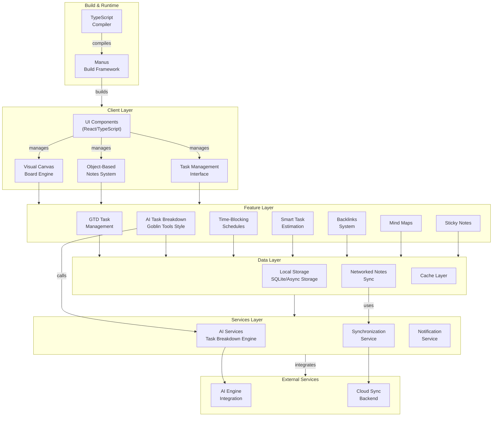

# ZenCanvas Mobile App - Architecture Overview

## System Architecture

## Component Breakdown

### Client Layer
- **UI Components**: React-based user interface built with TypeScript
- **Visual Canvas Board Engine**: Core canvas rendering and interaction system
- **Object-Based Notes System**: Network-structured note management
- **Task Management Interface**: GTD and task-related UI

### Feature Layer
- **GTD Task Management**: Getting Things Done methodology implementation
- **AI Task Breakdown**: Goblin Tools-style AI-powered task decomposition
- **Time-Blocking Schedules**: Schedule visualization and management
- **Smart Task Estimation**: Intelligent task duration prediction
- **Backlinks System**: Bi-directional note references
- **Mind Maps**: Visual hierarchical thinking tool
- **Sticky Notes**: Quick note-taking interface

### Data Layer
- **Local Storage**: SQLite or async storage for persistence
- **Networked Notes Sync**: Object-based note synchronization
- **Cache Layer**: Performance optimization for frequently accessed data

### Services Layer
- **AI Services**: Task breakdown and estimation engine
- **Synchronization Service**: Handle network note syncing
- **Notification Service**: User notifications and reminders

### Build & Runtime
- **Manus**: Custom build framework for TypeScript/JavaScript compilation
- **TypeScript Compiler**: Type-safe compilation pipeline

## Technology Stack

- **Language**: TypeScript (96.7%), JavaScript (2.4%)
- **Build Framework**: Manus
- **Architecture Pattern**: Feature-based modular architecture with service layer abstraction
